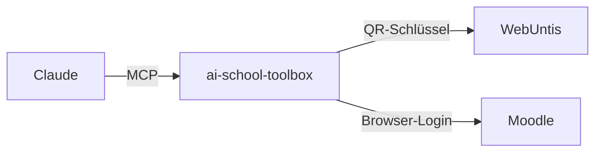

<div align="center">

# 🎒 ai-school-toolbox

**WebUntis + Moodle als MCP-Connector.** Stundenplan, Prüfungen, Abgaben und Noten direkt im Chat.


</div>

Frag einfach *„Was steht morgen an?“*, *„Welche Moodle-Abgaben sind offen?“* oder *„Mach mir einen Lernplan für die nächsten Schularbeiten“*.

## Setup

1. **Zugangsdaten holen:** In WebUntis unter *Profil → Freigaben → Zugriff über Untis Mobile* das QR-Symbol anklicken. Dort stehen Schule, Url, Benutzer und Schlüssel. Für Moodle brauchst du Adresse, Benutzername und Passwort.
2. **Deployen:** Repo forken und auf [Vercel](https://vercel.com/new) importieren.
3. **Variablen setzen:**

   | Variable | | Wert |
   | --- | :---: | --- |
   | `WEBUNTIS_SCHOOL` | ✅ | „Schule“ |
   | `WEBUNTIS_USERNAME` | ✅ | „Benutzer“ |
   | `WEBUNTIS_SECRET` | ✅ | „Schlüssel“ (alternativ `WEBUNTIS_PASSWORD`) |
   | `WEBUNTIS_URL` | | „Url“, sonst automatisch ermittelt |
   | `MOODLE_URL`, `MOODLE_USERNAME`, `MOODLE_PASSWORD` | | Für die Moodle-Tools |
   | `MCP_SECRET` | ✅ | Langer Zufallswert (`openssl rand -hex 32`) |

4. **Verbinden:** In Claude unter *Einstellungen → Connectors* einen eigenen Connector mit dieser URL hinzufügen:

   ```
   https://<dein-projekt>.vercel.app/mcp/<MCP_SECRET>
   ```

📖 Schritt für Schritt mit Screenshots, Cloudflare-Alternative und Fehlerbehebung: **[docs/SETUP.md](docs/SETUP.md)**

## So funktioniert's



Der Server meldet sich mit deinen Zugangsdaten bei WebUntis und Moodle an und stellt die Daten als **nur lesende Tools** bereit. Moodle braucht dafür **keinen API-Zugang**: Der Server loggt sich wie ein Browser ein und nutzt die interne Schnittstelle der Moodle-Webseite.

| | Tools |
| --- | --- |
| **WebUntis** | Stundenplan mit Entfall und Vertretung, Prüfungen, Hausaufgaben, Fehlstunden, Ferien, Mitteilungen, Fächer |
| **Moodle** | Abgaben und Fristen, Kurse, Kursinhalte, Noten, Benachrichtigungen, Login-Test |
| **Prompts** | Was steht morgen an?, Wochenüberblick, Lernplan, Fehlstunden-Check, Moodle-To-do |

Dazu gibt es einen [Skill](skills/schul-assistent/SKILL.md), der Claude zeigt, wie es die Tools am besten kombiniert, und einen ICS-Kalender mit deinen Prüfungen unter `/api/sync`.

## FAQ

<details>
<summary><b>Sind meine Daten sicher?</b></summary>

Alle Tools sind nur lesend. Zugangsdaten liegen nur in den Umgebungsvariablen deines Hostings und tauchen nie in Antworten auf. Der Endpoint ist per `MCP_SECRET` geschützt, teile die Connector-URL deshalb mit niemandem. Den WebUntis-Schlüssel kannst du jederzeit unter *Zugriff über Untis Mobile* neu erzeugen.

</details>

<details>
<summary><b>Ich melde mich bei WebUntis über Microsoft oder Google an.</b></summary>

Kein Problem: Nutze `WEBUNTIS_SECRET` statt eines Passworts. Bei Moodle funktioniert aktuell nur der normale Login mit Benutzername und Passwort.

</details>

<details>
<summary><b>Geht das auch mit Claude Code oder Claude Desktop?</b></summary>

Claude Code:

```bash
claude mcp add schule --transport http https://<dein-projekt>.vercel.app/mcp/<MCP_SECRET>
```

Claude Desktop ohne Hosting: `pnpm build` ausführen und `node dist/mcp/stdio.js` mit denselben Variablen als lokalen MCP-Server eintragen.

</details>

<details>
<summary><b>Kann ich statt Vercel auch Cloudflare oder Railway nutzen?</b></summary>

Ja. Cloudflare geht über einen Tunnel zu einem eigenen Rechner, siehe [docs/SETUP.md](docs/SETUP.md). Auf Railway oder einem eigenen Server läuft das Projekt als normaler Node-Server mit `pnpm build && pnpm start`.

</details>

## Mitwirken

Issues und Pull Requests sind willkommen, z. B. für neue Tools oder Support für weitere Schul-Plattformen.

```bash
pnpm install
pnpm dev     # Server auf http://localhost:3333
pnpm build   # TypeScript kompilieren
```

Lokale Zugangsdaten kommen in eine `.env` (Vorlage: [`.env.example`](.env.example)).

| Datei | Inhalt |
| --- | --- |
| `src/lib/untis.ts` | WebUntis-Login (Schlüssel, Passwort, QR, Server-Suche) |
| `src/lib/moodle.ts` | Moodle-Login per Session |
| `src/mcp/server.ts` | MCP-Server und WebUntis-Tools |
| `src/mcp/moodle-tools.ts` | Moodle-Tools |
| `src/mcp/prompts.ts` | Prompts |
| `src/mcp/http.ts` | HTTP-Endpoint mit Secret |
