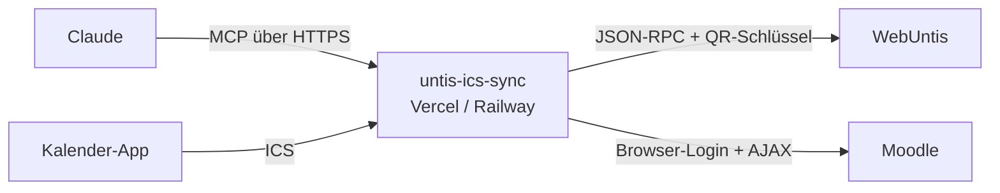

<div align="center">

# 🎒 untis-ics-sync

**Dein Schulalltag direkt in Claude: WebUntis + Moodle als MCP-Connector.**

Frag einfach *„Was steht morgen an?“*, *„Welche Moodle-Abgaben sind offen?“* oder *„Mach mir einen Lernplan für die nächsten Schularbeiten“*. Claude holt sich Stundenplan, Prüfungen, Hausaufgaben, Abgaben und Noten selbst.


</div>

## ✨ Features

- 🤖 **MCP-Server für Claude:** claude.ai, Claude App, Claude Desktop und Claude Code
- 📅 **WebUntis:** Stundenplan mit Entfall und Vertretungen, Prüfungen, Hausaufgaben, Fehlstunden, Ferien, Mitteilungen
- 🎓 **Moodle ohne API-Zugang:** Abgaben und Fristen, Kurse, Kursinhalte, Noten, Benachrichtigungen
- 🔑 **Login per QR-Schlüssel:** funktioniert auch bei Microsoft- oder Google-Login, kein Passwort nötig
- 🧭 **Findet deinen Schulserver selbst** über die offizielle WebUntis-Schulsuche
- 💬 **Fertige Prompts:** „Was steht morgen an?“, Wochenüberblick, Lernplan, Fehlstunden-Check, Moodle-To-do
- 📆 **ICS-Kalender:** Prüfungen als abonnierbarer Kalender unter `/api/sync`
- 🔒 **Nur lesend und geschützt** per Secret, Zugangsdaten bleiben in deinen Umgebungsvariablen

## 🧩 So funktioniert's



Moodle wird **ohne Web-Service-Token** angebunden: Der Server meldet sich wie ein Browser über das normale Login-Formular an und nutzt dann die interne AJAX-Schnittstelle, die auch die Moodle-Webseite selbst verwendet. Das klappt auch, wenn die Schule die Moodle-App-Schnittstelle deaktiviert hat.

## 🚀 In 5 Minuten startklar

### 1. Zugangsdaten holen

**WebUntis:** In WebUntis auf *Profil → Freigaben → Datenzugriff → Anzeigen*. Dort stehen Schule, Url, Benutzer und Schlüssel.

**Moodle (optional):** Die Adresse deines Moodle sowie Benutzername und Passwort, mit denen du dich auf der Moodle-Webseite anmeldest.

### 2. Deployen

[](https://vercel.com/new/clone?repository-url=https://github.com/builtbybengt/untis-ics-sync&env=WEBUNTIS_SCHOOL,WEBUNTIS_USERNAME,WEBUNTIS_SECRET,MCP_SECRET)

Oder manuell: Repo in Vercel importieren (das Framework-Preset wird per `vercel.json` auf Express gesetzt).

### 3. Umgebungsvariablen setzen

| Variable | Pflicht | Beschreibung |
| --- | :---: | --- |
| `WEBUNTIS_SCHOOL` | ✅ | „Schule“ aus dem Datenzugriff, z. B. `htbla-kaindorf` |
| `WEBUNTIS_USERNAME` | ✅ | „Benutzer“ aus dem Datenzugriff |
| `WEBUNTIS_SECRET` | ✅* | „Schlüssel“ aus dem Datenzugriff |
| `WEBUNTIS_PASSWORD` | ✅* | Alternativ: normales WebUntis-Passwort (nicht bei Microsoft-/Google-Login) |
| `WEBUNTIS_URL` | – | „Url“, z. B. `meine-schule.webuntis.com`. Wird sonst automatisch ermittelt |
| `WEBUNTIS_QR_CODE` | – | Alternativ zu allem oben: der komplette QR-Text `untis://setschool?...` |
| `MOODLE_URL` | – | z. B. `https://moodle.meine-schule.at`. Ohne diese Variable gibt es keine Moodle-Tools |
| `MOODLE_USERNAME` | – | Moodle-Benutzername |
| `MOODLE_PASSWORD` | – | Moodle-Passwort |
| `MCP_SECRET` | ✅ | Langer Zufallswert, schützt den Endpoint (`openssl rand -hex 32`) |

\* entweder `WEBUNTIS_SECRET` oder `WEBUNTIS_PASSWORD`

### 4. Mit Claude verbinden

In Claude unter *Einstellungen → Connectors → Eigenen Connector hinzufügen*:

```
https://<dein-projekt>.vercel.app/mcp/<MCP_SECRET>
```

Fertig. Teste es mit *„Was steht morgen an?“*.

> Das Secret steckt in der URL. Teile sie mit niemandem. Alternativ geht `?key=<MCP_SECRET>` oder der Header `Authorization: Bearer <MCP_SECRET>`.

## 🛠️ Tools

### WebUntis

| Tool | Was es liefert |
| --- | --- |
| `get_timetable` | Stundenplan für einen Zeitraum, inkl. Entfall (`cancelled`) und Vertretung (`irregular`) |
| `get_exams` | Prüfungen, Tests und Schularbeiten |
| `get_homework` | Hausaufgaben mit Fälligkeitsdatum |
| `get_absences` | Fehlstunden und Entschuldigungsstatus |
| `get_holidays` | Ferien und schulfreie Tage |
| `get_news` | Mitteilungen des Tages |
| `get_subjects` | Fächer mit Kürzel und Langname |

### Moodle

| Tool | Was es liefert |
| --- | --- |
| `moodle_check_login` | Testet den Login, gibt Name und Benutzer-ID zurück |
| `moodle_get_deadlines` | Anstehende und überfällige Abgaben, Tests und Termine |
| `moodle_get_courses` | Eigene Kurse mit Fortschritt |
| `moodle_get_course_contents` | Abschnitte und Aktivitäten eines Kurses |
| `moodle_get_grades` | Gesamtnote pro Kurs |
| `moodle_get_notifications` | Neueste Benachrichtigungen |

## 💬 Prompts

Diese Vorlagen zeigt Claude direkt beim Connector an:

| Prompt | Wofür |
| --- | --- |
| `morgen` | Was steht morgen an? Zeiten, Entfälle, Prüfungen, Abgaben |
| `wochenueberblick` | Die Schulwoche nach Tagen plus die 3 wichtigsten To-dos |
| `lernplan` | Lernplan für die anstehenden Prüfungen |
| `fehlstunden` | Fehlstunden-Zusammenfassung mit offenen Entschuldigungen |
| `moodle_todo` | Priorisierte Liste aller offenen Moodle-Abgaben |

## 🧠 Claude-Skill

Im Ordner [`skills/schul-assistent`](skills/schul-assistent/SKILL.md) liegt ein Skill, der Claude beibringt, wie es die Tools am besten kombiniert (z. B. Entfälle hervorheben, Kürzel übersetzen, überfällige Abgaben zuerst).

Installieren: Ordner als ZIP packen und in Claude unter *Einstellungen → Fähigkeiten → Skills* hochladen.

```bash
cd skills && zip -r schul-assistent.zip schul-assistent
```

## 💻 Weitere Clients

<details>
<summary><b>Claude Code</b></summary>

```bash
claude mcp add schule --transport http https://<dein-projekt>.vercel.app/mcp/<MCP_SECRET>
```

</details>

<details>
<summary><b>Claude Desktop (lokal, ohne Hosting)</b></summary>

```bash
pnpm install && pnpm build
```

`claude_desktop_config.json`:

```json
{
  "mcpServers": {
    "schule": {
      "command": "node",
      "args": ["/pfad/zu/untis-ics-sync/dist/mcp/stdio.js"],
      "env": {
        "WEBUNTIS_SCHOOL": "meine-schule",
        "WEBUNTIS_USERNAME": "max.mustermann",
        "WEBUNTIS_SECRET": "<Schlüssel aus dem Datenzugriff>",
        "MOODLE_URL": "https://moodle.meine-schule.at",
        "MOODLE_USERNAME": "max.mustermann",
        "MOODLE_PASSWORD": "<Moodle-Passwort>"
      }
    }
  }
}
```

</details>

<details>
<summary><b>Railway / eigener Server</b></summary>

Läuft als normaler Express-Server (`pnpm build && pnpm start`, Port über `PORT`, Standard `3333`). Auf Railway wird `PORT` automatisch gesetzt.

</details>

## 📆 ICS-Kalender

`GET /api/sync` liefert deine Prüfungen der nächsten 12 Monate als `.ics`. Die URL kannst du in Google Kalender, Apple Kalender oder Outlook abonnieren.

## 🔒 Sicherheit

- Alle Tools sind **nur lesend**. Es wird nichts in WebUntis oder Moodle verändert.
- Zugangsdaten liegen nur in den Umgebungsvariablen deines Hostings und werden nie in Antworten oder Fehlermeldungen ausgegeben.
- Der MCP-Endpoint ist per `MCP_SECRET` geschützt. Wenn du den QR-Schlüssel versehentlich geteilt hast, erzeug in WebUntis unter *Datenzugriff* einen neuen.

## 🧑‍💻 Entwicklung

```bash
pnpm install
pnpm dev          # Dev-Server auf http://localhost:3333
pnpm build        # TypeScript kompilieren
pnpm mcp:stdio    # MCP-Server über stdio starten
```

Struktur:

```
src/
├── index.ts            Express-App (/api/sync, /mcp)
├── lib/untis.ts        WebUntis-Login (Passwort, Schlüssel, QR, Server-Suche)
├── lib/moodle.ts       Moodle-Login per Session + AJAX
├── mcp/server.ts       MCP-Server mit WebUntis-Tools
├── mcp/moodle-tools.ts Moodle-Tools
├── mcp/prompts.ts      Fertige Prompts
├── mcp/http.ts         Streamable-HTTP-Endpoint mit Secret
└── mcp/stdio.ts        stdio-Einstieg für Claude Desktop
```
