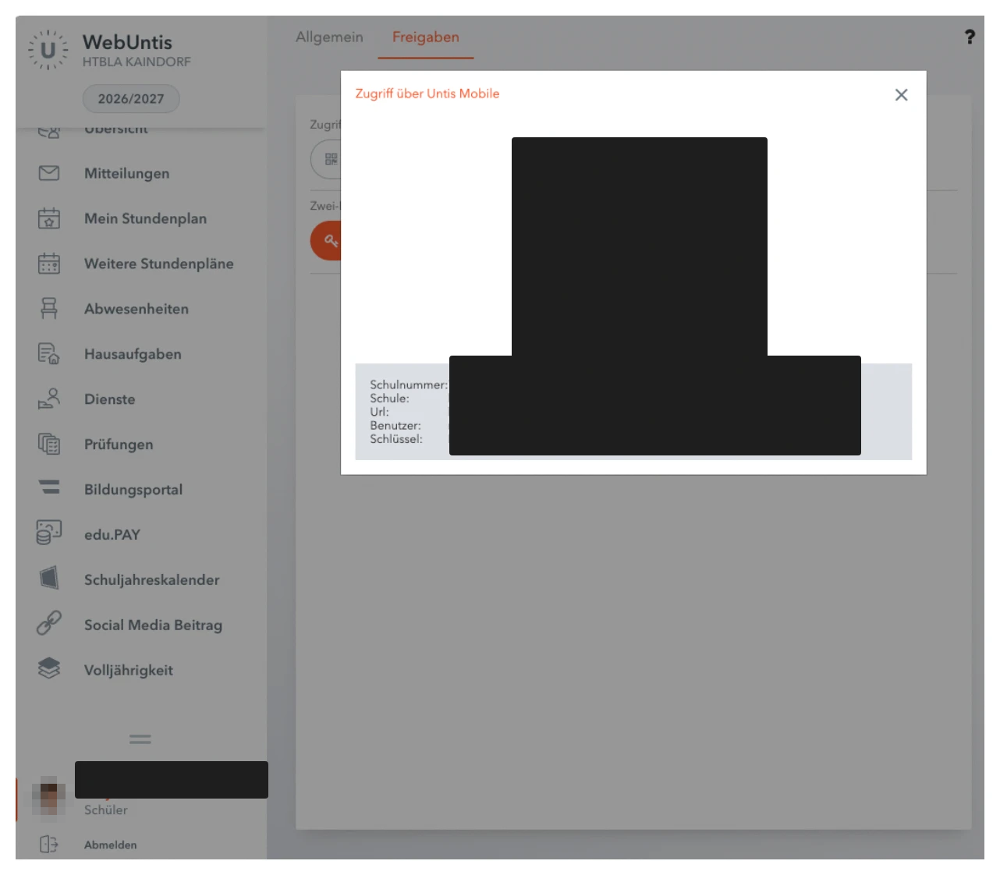
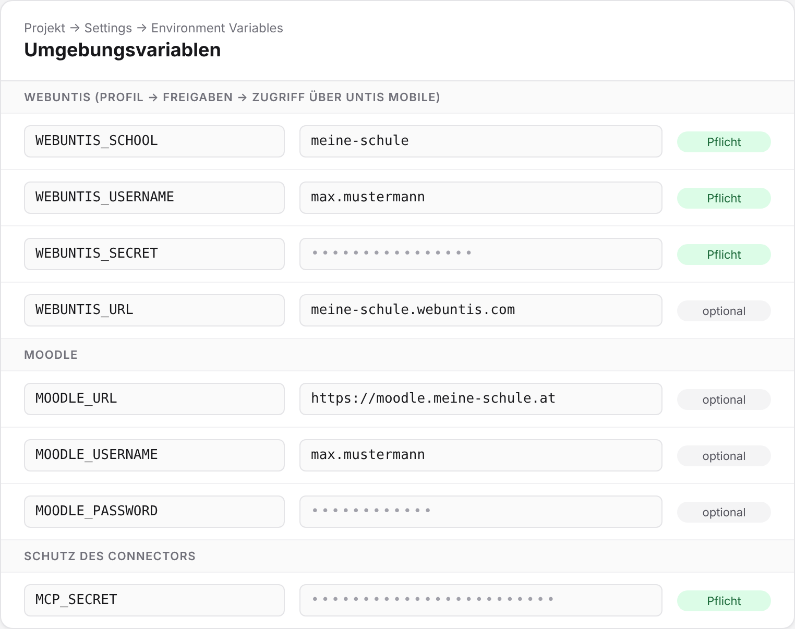
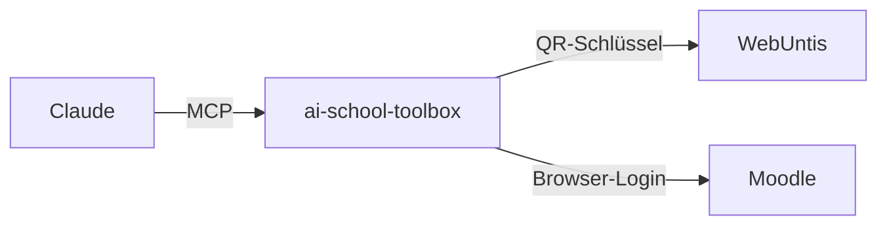

<div align="center">

# 🎒 ai-school-toolbox

**WebUntis + Moodle als MCP-Connector.** Stundenplan, Prüfungen, Abgaben und Noten direkt im Chat.


</div>

## Setup

In etwa 10 Minuten ist dein eigener Connector online. Du brauchst einen GitHub-Account und einen kostenlosen Vercel-Account.

### 1. Zugangsdaten holen

**WebUntis:** Klick in WebUntis unten links auf deinen Namen, wechsle auf den Reiter **Freigaben** und klick bei **Zugriff über Untis Mobile** auf das QR-Symbol.



Du brauchst Schule, Url, Benutzer und Schlüssel. Die Schulnummer ist nicht nötig.

> ⚠️ Der Schlüssel ist wie ein Passwort. Falls er doch mal irgendwo gelandet ist: im selben Fenster einfach einen neuen erzeugen.

**Moodle (optional):** Adresse deines Moodle, Benutzername und Passwort.

**Connector-Secret:** Ein langer Zufallswert, z. B. von `openssl rand -hex 32` oder einem Passwort-Generator (mindestens 32 Zeichen).

### 2. Auf Vercel deployen

[](https://vercel.com/new/clone?repository-url=https%3A%2F%2Fgithub.com%2Fbuiltbybengt%2Fai-school-toolbox&project-name=ai-school-toolbox&repository-name=ai-school-toolbox&env=WEBUNTIS_SCHOOL,WEBUNTIS_USERNAME,WEBUNTIS_SECRET,MCP_SECRET&envDescription=WebUntis-Zugangsdaten%20aus%20Profil%20%E2%86%92%20Freigaben%20%E2%86%92%20Zugriff%20%C3%BCber%20Untis%20Mobile%20und%20ein%20langer%20Zufallswert%20als%20MCP_SECRET&envLink=https%3A%2F%2Fgithub.com%2Fbuiltbybengt%2Fai-school-toolbox%23setup)

Der Button kopiert das Repo in deinen GitHub-Account und fragt direkt die Pflicht-Variablen ab. Moodle-Variablen trägst du danach unter **Settings → Environment Variables** nach.

Oder manuell:

1. Repo oben rechts **forken**.
2. Auf [vercel.com/new](https://vercel.com/new) mit GitHub anmelden und den Fork importieren.
3. Unter **Environment Variables** die Werte eintragen:

   | Variable | | Wert |
   | --- | :---: | --- |
   | `WEBUNTIS_SCHOOL` | ✅ | „Schule“ |
   | `WEBUNTIS_USERNAME` | ✅ | „Benutzer“ |
   | `WEBUNTIS_SECRET` | ✅ | „Schlüssel“ (alternativ `WEBUNTIS_PASSWORD` mit dem normalen Passwort) |
   | `WEBUNTIS_URL` | | „Url“, sonst automatisch ermittelt |
   | `MOODLE_URL` | | z. B. `https://moodle.meine-schule.at`, ohne sie gibt es keine Moodle-Tools |
   | `MOODLE_USERNAME`, `MOODLE_PASSWORD` | | Moodle-Login |
   | `MCP_SECRET` | ✅ | Das Connector-Secret |

   

4. **Deploy** klicken. Nach etwa einer Minute bekommst du eine Adresse wie `https://ai-school-toolbox-xyz.vercel.app`.

Das Framework-Preset stellt `vercel.json` automatisch auf Express, `PORT` brauchst du nicht. Werte später geändert? Unter **Settings → Environment Variables** anpassen und unter **Deployments → Redeploy** neu deployen.

### 3. Mit Claude verbinden

In Claude unter **Einstellungen → Connectors** einen eigenen Connector hinzufügen:

```
https://<deine-vercel-adresse>/mcp/<MCP_SECRET>
```

Testen mit *„Was steht morgen an?“* oder *„Teste meinen Moodle-Login“*. Optional den [Skill](skills/schul-assistent/SKILL.md) als ZIP unter **Einstellungen → Fähigkeiten → Skills** hochladen.

<details>
<summary><b>Alternative: Cloudflare Tunnel</b></summary>

Cloudflare Workers führen keine Express-Apps aus. Stattdessen läuft der Server auf einem eigenen Rechner (Raspberry Pi, Heim-PC, VPS) und Cloudflare macht ihn per HTTPS erreichbar. Der Rechner muss dauerhaft laufen.

```bash
git clone https://github.com/<dein-name>/ai-school-toolbox.git
```

```bash
cd ai-school-toolbox && cp .env.example .env
```

`.env` mit deinen Werten füllen, dann:

```bash
pnpm install && pnpm build && pnpm start
```

```bash
cloudflared tunnel --url http://localhost:3333
```

Die angezeigte `https://….trycloudflare.com`-Adresse nutzt du in Schritt 3. Für eine feste Adresse richtest du im Cloudflare-Dashboard unter **Zero Trust → Networks → Tunnels** einen benannten Tunnel ein. [cloudflared installieren](https://developers.cloudflare.com/cloudflare-one/connections/connect-networks/downloads/)

</details>

<details>
<summary><b>Probleme?</b></summary>

| Fehlermeldung | Lösung |
| --- | --- |
| `bad credentials` | Benutzer oder Schlüssel falsch. Keine Leerzeichen oder Anführungszeichen, danach neu deployen. |
| `invalid schoolname` / Schule nicht gefunden | `WEBUNTIS_SCHOOL` muss genau der Wert „Schule“ sein. |
| `Fehlende Umgebungsvariablen: …` | Die genannte Variable fehlt. Eintragen und neu deployen. |
| `Moodle-Login fehlgeschlagen` | Login direkt auf der Moodle-Webseite testen. Microsoft-/Google-Login wird für Moodle nicht unterstützt. |
| `401 Unauthorized` | `MCP_SECRET` in der Connector-URL stimmt nicht mit Vercel überein. |
| Moodle-Tools fehlen | `MOODLE_URL` setzen, neu deployen und den Connector in Claude neu verbinden. |

</details>

## So funktioniert's



Der Server meldet sich mit deinen Zugangsdaten bei WebUntis und Moodle an und stellt die Daten als **nur lesende Tools** bereit. Moodle braucht dafür **keinen API-Zugang**: Der Server loggt sich wie ein Browser ein und nutzt die interne Schnittstelle der Moodle-Webseite.

| | Tools |
| --- | --- |
| **WebUntis** | Stundenplan mit Entfall und Vertretung, Prüfungen, Hausaufgaben, Fehlstunden, Ferien, Mitteilungen, Fächer |
| **Moodle** | Abgaben und Fristen, Kurse, Kursinhalte, Noten, Benachrichtigungen, Login-Test |
| **Prompts** | Was steht morgen an?, Wochenüberblick, Lernplan, Fehlstunden-Check, Moodle-To-do |

Dazu gibt es einen [Skill](skills/schul-assistent/SKILL.md), der Claude zeigt, wie es die Tools am besten kombiniert, und einen ICS-Kalender mit deinen Prüfungen unter `/api/sync`.

## FAQ

<details>
<summary><b>Sind meine Daten sicher?</b></summary>

Alle Tools sind nur lesend. Zugangsdaten liegen nur in den Umgebungsvariablen deines Hostings und tauchen nie in Antworten auf. Der Endpoint ist per `MCP_SECRET` geschützt, teile die Connector-URL deshalb mit niemandem. Den WebUntis-Schlüssel kannst du jederzeit unter *Zugriff über Untis Mobile* neu erzeugen.

</details>

<details>
<summary><b>Ich melde mich bei WebUntis über Microsoft oder Google an.</b></summary>

Kein Problem: Nutze `WEBUNTIS_SECRET` statt eines Passworts. Bei Moodle funktioniert aktuell nur der normale Login mit Benutzername und Passwort.

</details>

<details>
<summary><b>Geht das auch mit Claude Code oder Claude Desktop?</b></summary>

Claude Code:

```bash
claude mcp add schule --transport http https://<dein-projekt>.vercel.app/mcp/<MCP_SECRET>
```

Claude Desktop ohne Hosting: `pnpm build` ausführen und `node dist/mcp/stdio.js` mit denselben Variablen als lokalen MCP-Server eintragen.

</details>

<details>
<summary><b>Kann ich statt Vercel auch Cloudflare oder Railway nutzen?</b></summary>

Ja. Cloudflare geht über einen Tunnel zu einem eigenen Rechner, siehe oben unter Setup. Auf Railway oder einem eigenen Server läuft das Projekt als normaler Node-Server mit `pnpm build && pnpm start`.

</details>

## Mitwirken

Issues und Pull Requests sind willkommen, z. B. für neue Tools oder Support für weitere Schul-Plattformen.

```bash
pnpm install
pnpm dev     # Server auf http://localhost:3333
pnpm build   # TypeScript kompilieren
```

Lokale Zugangsdaten kommen in eine `.env` (Vorlage: [`.env.example`](.env.example)).

| Datei | Inhalt |
| --- | --- |
| `src/lib/untis.ts` | WebUntis-Login (Schlüssel, Passwort, QR, Server-Suche) |
| `src/lib/moodle.ts` | Moodle-Login per Session |
| `src/mcp/server.ts` | MCP-Server und WebUntis-Tools |
| `src/mcp/moodle-tools.ts` | Moodle-Tools |
| `src/mcp/prompts.ts` | Prompts |
| `src/mcp/http.ts` | HTTP-Endpoint mit Secret |
