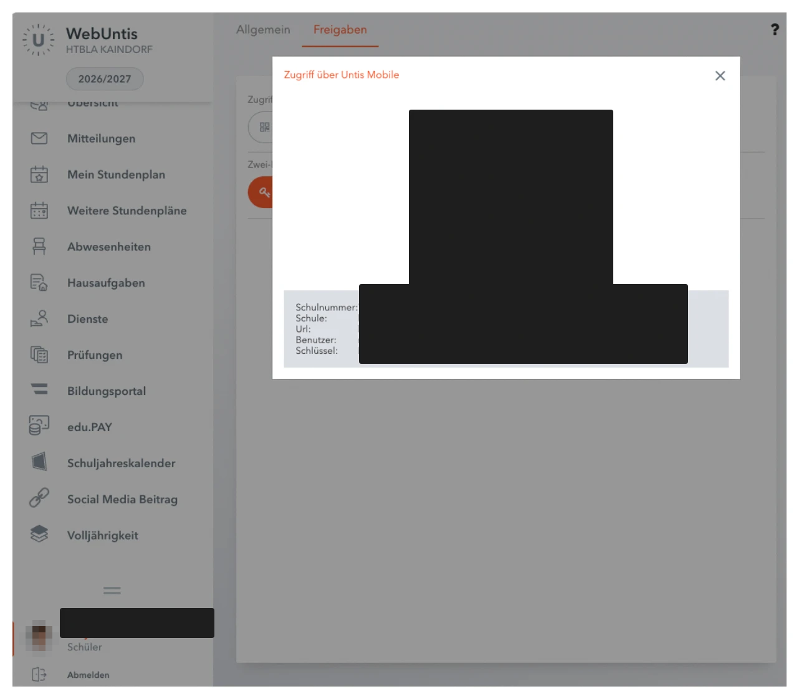
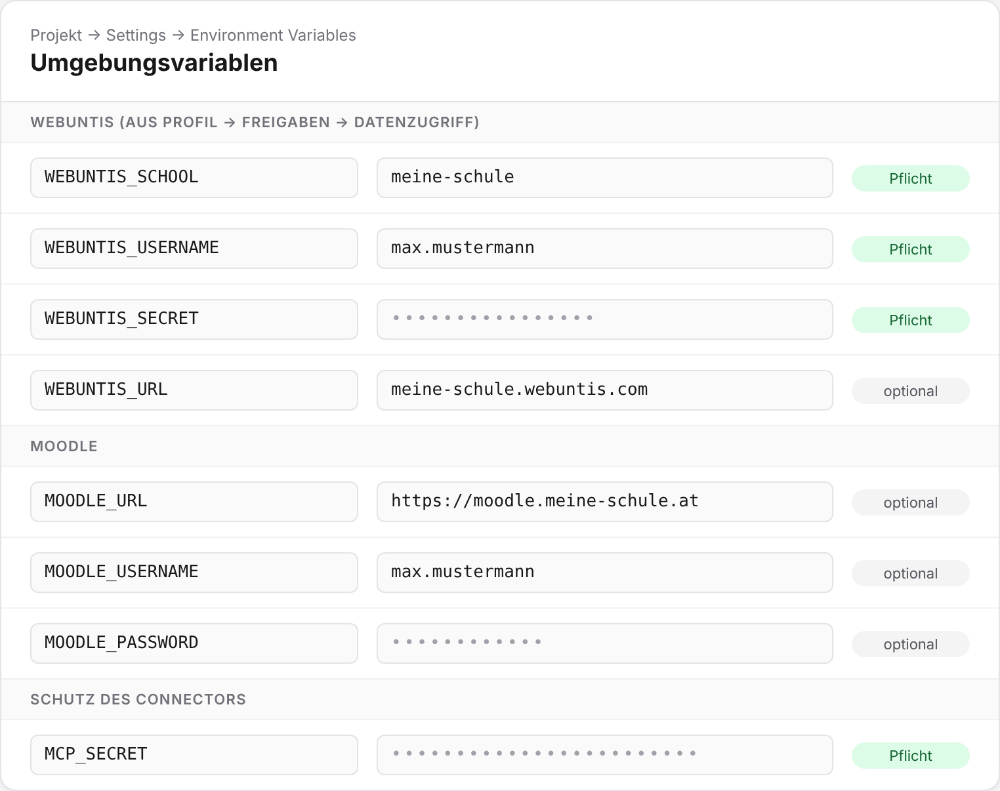

# 🚀 Setup-Guide

In etwa 10 Minuten hast du deinen eigenen Schul-Connector online. Du brauchst nur einen GitHub-Account und einen kostenlosen Vercel-Account.

## Schritt 1: Zugangsdaten sammeln

**WebUntis:** Öffne WebUntis im Browser und geh auf **Profil → Freigaben → Datenzugriff → Anzeigen**. Dort siehst du einen QR-Code und darunter vier Werte:

| Im Datenzugriff | Wird zu |
| --- | --- |
| Schule | `WEBUNTIS_SCHOOL` |
| Url | `WEBUNTIS_URL` |
| Benutzer | `WEBUNTIS_USERNAME` |
| Schlüssel | `WEBUNTIS_SECRET` |

<!-- Screenshot vom WebUntis-Datenzugriff hier einfügen (Schlüssel unkenntlich machen!):

-->

> ⚠️ Der Schlüssel ist wie ein Passwort. Teile ihn mit niemandem. Falls er doch mal irgendwo gelandet ist: im selben Menü einfach einen neuen erzeugen.

**Moodle (optional):** Die Adresse deines Moodle (z. B. `https://moodle.meine-schule.at`) und Benutzername und Passwort, mit denen du dich dort anmeldest.

**Connector-Secret:** Denk dir einen langen Zufallswert aus, z. B. mit:

```bash
openssl rand -hex 32
```

Oder nimm einen Passwort-Generator mit mindestens 32 Zeichen. Das ist `MCP_SECRET`.

## Schritt 2: Auf Vercel hosten (empfohlen)

1. Forke dieses Repo auf GitHub (oben rechts **Fork**).
2. Geh auf [vercel.com/new](https://vercel.com/new), melde dich mit GitHub an und importiere deinen Fork.
3. Beim Import unter **Environment Variables** die Werte aus Schritt 1 eintragen:



4. Auf **Deploy** klicken. Nach etwa einer Minute bekommst du eine Adresse wie `https://untis-ics-sync-xyz.vercel.app`.

Das Framework-Preset musst du nicht ändern, `vercel.json` stellt es automatisch auf Express. `PORT` brauchst du auf Vercel nicht.

> Werte später geändert? Unter **Settings → Environment Variables** anpassen und danach unter **Deployments → Redeploy** neu deployen. Erst dann gelten die neuen Werte.

## Schritt 3: Mit Claude verbinden

1. In Claude: **Einstellungen → Connectors → Eigenen Connector hinzufügen**.
2. Name: z. B. `Schule`
3. URL:

```
https://<deine-vercel-adresse>/mcp/<MCP_SECRET>
```

4. Speichern und testen, z. B. mit *„Was steht morgen an?“* oder *„Teste meinen Moodle-Login“*.

Optional: Den Skill aus [`skills/schul-assistent`](../skills/schul-assistent/SKILL.md) als ZIP unter **Einstellungen → Fähigkeiten → Skills** hochladen.

## Alternative: Cloudflare

Cloudflare Workers führen keine Express-Apps aus, deshalb läuft dieses Projekt nicht direkt als Worker. Was funktioniert, ist ein **Cloudflare Tunnel**: Der Server läuft auf einem eigenen Rechner (Raspberry Pi, Heim-PC, VPS), und Cloudflare macht ihn sicher per HTTPS erreichbar. Der Rechner muss dafür dauerhaft laufen.

1. Projekt auf dem Rechner einrichten:

```bash
git clone https://github.com/<dein-name>/untis-ics-sync.git
```

```bash
cd untis-ics-sync && cp .env.example .env
```

2. `.env` mit den Werten aus Schritt 1 füllen, dann bauen und starten:

```bash
pnpm install && pnpm build && pnpm start
```

3. Tunnel starten ([cloudflared installieren](https://developers.cloudflare.com/cloudflare-one/connections/connect-networks/downloads/)):

```bash
cloudflared tunnel --url http://localhost:3333
```

`cloudflared` zeigt eine Adresse wie `https://irgendwas.trycloudflare.com`. Die nutzt du in Schritt 3 statt der Vercel-Adresse. Für eine feste Adresse mit eigener Domain richtest du im Cloudflare-Dashboard unter **Zero Trust → Networks → Tunnels** einen benannten Tunnel ein.

## Probleme?

| Fehlermeldung | Lösung |
| --- | --- |
| `bad credentials` | Benutzer oder Schlüssel falsch. Werte im Datenzugriff prüfen, keine Leerzeichen oder Anführungszeichen, danach neu deployen. |
| `invalid schoolname` / Schule nicht gefunden | `WEBUNTIS_SCHOOL` muss genau der Wert „Schule“ aus dem Datenzugriff sein. |
| `Fehlende Umgebungsvariablen: …` | Die genannte Variable fehlt in Vercel. Eintragen und neu deployen. |
| `Moodle-Login fehlgeschlagen` | Teste Benutzername und Passwort direkt auf der Moodle-Webseite. Login über Microsoft/Google wird für Moodle nicht unterstützt. |
| `401 Unauthorized` | Das `MCP_SECRET` in der Connector-URL stimmt nicht mit dem in Vercel überein. |
| Moodle-Tools fehlen in Claude | `MOODLE_URL` setzen, neu deployen und den Connector in Claude einmal trennen und neu verbinden. |
